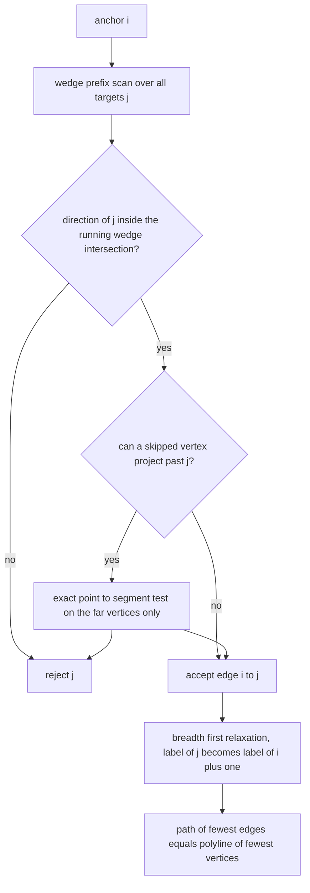
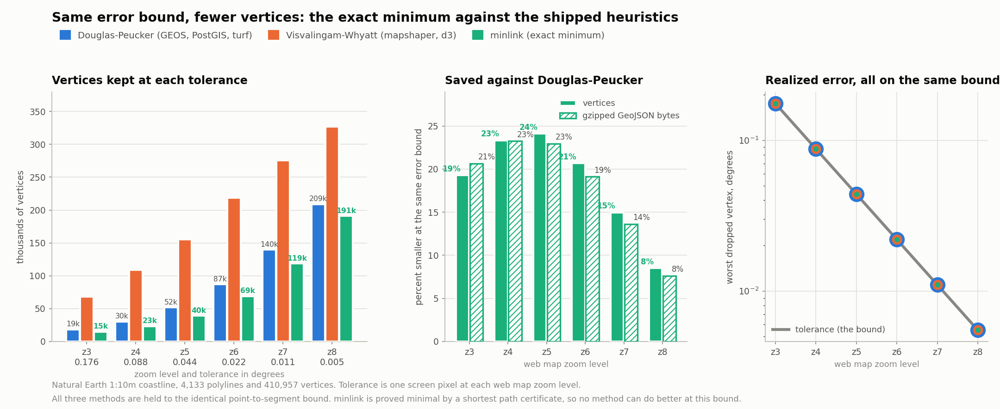
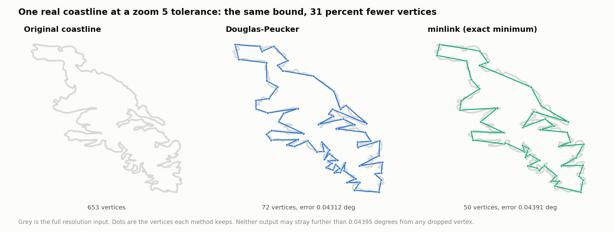

# minlink

Polyline simplification that keeps the provably fewest vertices for a given error bound, instead of however many a greedy split happens to leave behind.

## The problem

Every mapping stack simplifies vector geometry before it ships it. shapely and GEOS, PostGIS ST_Simplify, turf.js, QGIS and every vector tile pipeline run Douglas-Peucker; mapshaper, d3 and PostGIS ST_SimplifyVW offer Visvalingam-Whyatt as the alternative. Both are greedy. Douglas-Peucker finds the vertex that deviates most from the current chord, keeps it, and recurses: the split is chosen by local error and never by how many vertices that choice will cost further down the recursion. Visvalingam-Whyatt discards whichever vertex currently has the smallest triangle area.

Both stay inside the tolerance, so both are correct. Neither makes any claim about how many vertices survive, and nobody measures the gap, because measuring it needs an optimal answer to compare against and no geo library ships one. That gap is not academic: tile payloads are paid for in coordinates, and so is client side render time.

## What this does

minlink computes the simplification with the fewest possible vertices for a point-to-segment tolerance, and proves it.

The minimum vertex problem is not hard, it is a shortest path. Take the input vertices as nodes and add an edge from i to j when the single segment from i to j keeps every vertex it skips within eps. Any valid simplification is then a path from the first vertex to the last, and the one with the fewest vertices is the one with the fewest edges, which a breadth first sweep finds exactly.

- `simplify(points, eps)` returns the minimum vertex polyline.
- `min_vertex_indices(points, eps)` also returns the shortest path layer labels, which are an optimality certificate: `verify_optimality` confirms that no valid shortcut in the graph skips a layer, which proves that no shorter path exists.
- `simplify_to_budget(points, max_vertices)` inverts the problem for tile writers who are handed a vertex budget rather than a tolerance.
- The two shipped heuristics are included as baselines, so the comparison is reproducible rather than asserted. The local Douglas-Peucker is cross checked against GEOS through shapely and returns an identical vertex count on 250 of 250 sampled polylines.

Enumerating the edges naively costs a point-to-segment scan per pair. Instead each anchor is handled in two stages. Stage one is a necessary condition evaluated for all targets at once: a skipped vertex can only be within eps of the segment if it is within eps of the infinite line, and the directions that satisfy that for every skipped vertex form a shrinking intersection of angular wedges, which two prefix scans compute in a single vectorized pass. Stage two pays for an exact point-to-segment test only where a skipped vertex can project past the far endpoint, which the running maximum radius detects. `tests/test_core.py` asserts that this filter returns exactly the same edge set as a direct scan, for every pair, across fourteen polyline families including folded and spiral cases.

## Why it is interesting

The minimum vertex formulation is classical: Imai and Iri published it in 1988 and Chan and Chin gave the wedge based edge enumeration in 1996. It is in none of the shipped geo stacks. The whole ecosystem runs the greedy heuristic, and the price of that has not been measured on real basemap geometry.

Three things make the measurement worth having:

1. The gap is structural, not a property of one dataset. The exact answer can never lose, because it is a minimum, and the certificate makes that checkable per polyline rather than taken on faith.
2. The gap is largest exactly where a vertex budget binds. At coarse zoom levels one tile has to carry the geometry of a whole region, and that is where the greedy split wastes the most vertices.
3. A simplifier can always buy fewer vertices with more error, so the comparison holds all three methods to the identical realized point-to-segment bound and reports the realized error of each. The win is not a tolerance trick.

## Architecture

[FigJam board: minlink exact polyline simplification pipeline](https://www.figma.com/board/nCnIx6gYpHpwnTUwzr4W5Y)

The board shows how one polyline becomes a shortcut graph, how the two stage edge test avoids the quadratic point-to-segment scan, and where the optimality certificate and the two baseline heuristics attach to the measurement harness.

The inner loop in code terms:



## Results



The metric is the number of vertices kept, which is what a vector tile is billed in. The baseline is Douglas-Peucker, the algorithm GEOS, PostGIS and turf.js all ship, with Visvalingam-Whyatt alongside it at its most favourable stopping point. The corpus is the Natural Earth 1:10m coastline, 4,133 polylines and 410,957 vertices, and the tolerance at each zoom level is one screen pixel, which is the point below which detail cannot be displayed. Every method is held to that identical point-to-segment bound and the realized error of each is measured, so none of them is buying vertices with error.

At zoom 6, a regional view, Douglas-Peucker keeps 87,093 vertices and minlink keeps 69,071, a reduction of 20.7 percent, and the gzipped GeoJSON drops from 756 kB to 611 kB, 19.1 percent smaller. The advantage peaks at zoom 5 with 24.1 percent fewer vertices and narrows as the tolerance tightens, because a tight bound leaves a greedy split very little room to choose badly. Visvalingam-Whyatt trails both at every level, keeping 3.2 times as many vertices as minlink at zoom 6.

The saving survives transport compression, which is the part that is easy to get wrong. Dropping a vertex removes two coordinates outright rather than removing redundancy a compressor would have squeezed anyway, so 20.7 percent fewer vertices at zoom 6 still means 19.1 percent fewer gzipped bytes on the wire.

| zoom | tolerance (deg) | Douglas-Peucker | Visvalingam-Whyatt | minlink | fewer than DP | gzip DP | gzip minlink | gzip saved |
|---|---|---|---|---|---|---|---|---|
| z3 | 0.175781 | 18,523 | 67,976 | 14,948 | 19.3% | 163 kB | 129 kB | 20.7% |
| z4 | 0.087891 | 30,487 | 108,838 | 23,373 | 23.3% | 273 kB | 209 kB | 23.3% |
| z5 | 0.043945 | 52,094 | 155,464 | 39,530 | 24.1% | 462 kB | 356 kB | 23.0% |
| z6 | 0.021973 | 87,093 | 218,583 | 69,071 | 20.7% | 756 kB | 611 kB | 19.1% |
| z7 | 0.010986 | 139,746 | 275,680 | 118,818 | 15.0% | 1185 kB | 1024 kB | 13.6% |
| z8 | 0.005493 | 209,121 | 327,252 | 191,354 | 8.5% | 1733 kB | 1601 kB | 7.6% |

Two checks keep the comparison honest. The optimality certificate was verified on 4,020 polylines per zoom level (every polyline up to 400 vertices, where re-deriving the whole shortcut graph is cheap): all passed. And the realized error column of docs/metrics.json shows all three methods landing on the tolerance rather than under it, so the vertex counts are being compared at equal error, not at equal effort.



The same result on a single polyline, drawn by `python scripts/render_geometry.py`. The grey line is the full resolution input, the dots are the vertices each method keeps, and neither output is allowed to stray further from a dropped vertex than the other. The shapes are interchangeable; the vertex counts are not.

## How to run it

```bash
pip install -r requirements.txt

# one polyline, three simplifiers, one certificate check
python demo.py

# full measurement over the Natural Earth 1:10m coastline, writes docs/metrics.json
python scripts/benchmark.py --zooms 3,4,5,6,7,8

# redraw docs/before_after.png from those measurements
python scripts/make_chart.py

# correctness, including agreement with a brute force oracle
python tests/test_core.py
# or, with pytest installed
python -m pytest tests -q
```

The coastline layer is downloaded once from the Natural Earth mirror and cached in `data/`. A full sweep over all six zoom levels takes roughly twenty minutes, dominated by the handful of polylines with more than ten thousand vertices; `--max-vertices 1200` reproduces the shape of the result in about a minute.

Library use:

```python
import numpy as np
from minlink import min_vertex_indices, verify_optimality, zoom_tolerance

pts = np.array([[0.0, 0.0], [1.0, 0.1], [2.0, 0.0], [3.0, 0.4], [4.0, 0.0]])
eps = zoom_tolerance(3)                      # one screen pixel at zoom 3
idx, label = min_vertex_indices(pts, eps)    # -> [0, 2, 3, 4], one vertex dropped
assert verify_optimality(pts, eps, label)    # no fewer vertices can meet eps
simplified = pts[idx]
```

## Example output

A real run of `python demo.py` on the longest coastline polyline:

```
coastline polyline: 1193 vertices (longest in the layer is 16538)

zoom 4, tolerance 0.08789 degrees (one screen pixel)
  Douglas-Peucker        93 vertices, realized error 0.087589
  Visvalingam-Whyatt    430 vertices, realized error 0.057922
  minlink (exact)        63 vertices, realized error 0.087848, 0.4s
  minlink keeps 32.3% fewer vertices than Douglas-Peucker at the same bound

zoom 6, tolerance 0.02197 degrees (one screen pixel)
  Douglas-Peucker       300 vertices, realized error 0.021564
  Visvalingam-Whyatt    913 vertices, realized error 0.011277
  minlink (exact)       228 vertices, realized error 0.021859, 0.2s
  minlink keeps 24.0% fewer vertices than Douglas-Peucker at the same bound

zoom 8, tolerance 0.00549 degrees (one screen pixel)
  Douglas-Peucker       725 vertices, realized error 0.005459
  Visvalingam-Whyatt   1168 vertices, realized error 0.000462
  minlink (exact)       667 vertices, realized error 0.005486, 0.2s
  minlink keeps 8.0% fewer vertices than Douglas-Peucker at the same bound

optimality certificate on a 254 vertex polyline: verified
  no simplification with fewer than 29 vertices meets the 0.02197 degree bound

vertex budget inversion: 200 vertex budget met at tolerance 0.027562 degrees (198 vertices)
  that is 16.6% of the original 1193 vertices
```

## Honest limits

- Cost. The exact solver is quadratic in the vertices of a polyline where Douglas-Peucker is near linear. Over the whole 410,957 vertex corpus at zoom 6 it takes 135 seconds against 6 for Douglas-Peucker, and the cost is concentrated in the few polylines above ten thousand vertices. Simplification is a build step whose output is served many times, so that is usually the right trade, but it is a real cost and it is reported rather than hidden.
- Topology. Neither Douglas-Peucker with `preserve_topology=False` nor the exact solver keeps a line from crossing itself, and the harness counts it: at zoom 6 the exact output self intersects on 570 polylines against 517 for Douglas-Peucker. Fewer vertices means longer chords, so this is slightly worse, not better. Topology aware simplification is a different problem.
- The gap closes at fine tolerances. At zoom 8 the advantage is 8.5 percent, against 19.3 percent at zoom 3. The win lives at the coarse zoom levels, which is also where most basemap traffic sits.
- Error measure. Distance is point-to-segment in the input coordinate system, which for lon and lat degrees is the same measure GEOS bounds, not a geodesic one. Project first if metres matter.
- Vertex count is the objective, not perceived shape. Visvalingam-Whyatt survives in real tooling partly because its removal order looks better to the eye at aggressive settings, and it keeps a cleaner topology here. Its removal order is also coarse: on many polylines the most aggressive stop that still clears the bound lands well inside it, so it pays for vertices it cannot reclaim, which is part of why its margin here is so large. Minimum vertices at a fixed error bound is the claim being made, and nothing more.

## References

- H. Imai and M. Iri, Polygonal approximations of a curve: formulations and algorithms, 1988.
- W. S. Chan and F. Chin, Approximation of polygonal curves with minimum number of line segments or minimum error, 1996.
- D. Douglas and T. Peucker, Algorithms for the reduction of the number of points required to represent a digitized line or its caricature, 1973.
- M. Visvalingam and J. D. Whyatt, Line generalisation by repeated elimination of points, 1993.
